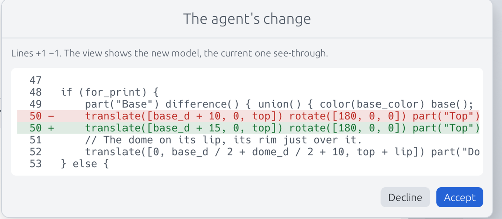

# The agent in the app

Talking to the agent is another way of editing the model, as typing the
code is: the editor column, on the left beside the view, switches
between the two with **Code · Agent** at its top (Cmd+L, or the speech
bubble in the top bar, switches to the agent and back; with the view
alone, it brings the column back beside it). The console stays under
both. The mode comes back at the next launch. In Agent mode, you write
to the agent as in a chat; it reads the document you have open, unsaved
edits included, and changes it in place: the view re-renders as if you
had typed its edits, and the code shows their lines marked once you
switch back to it. Each edit is one step of the undo history, and the
edits of one answer can be undone together. A reply's **Edited line N**
link switches to the code at that line.

While you work in the code, the Agent segment turns a small spinner
while the agent is at work, then keeps a dot until you open it, when it
answered meanwhile.

The top bar's **Editor · Side by side · View** shares the window between
the editor column, whatever its mode, and the view.

It uses the same tools as `c2f mcp` (see the
[README](../README.md#ai-agents-mcp)), plus the studio's live tools, which
act on what is on screen rather than on files.

## Choosing the engine

Settings › Agent chooses what runs the agent: **Claude Code**, the
**Anthropic API**, or **Automatic**. The page says which one the agent
will run on, and why another cannot; **Check again** looks again after
you install or log in.

### Claude Code, with your own subscription

The studio runs the `claude` command you installed and logged in with
your own subscription. It needs:
- Claude Code 2.1.300 or newer; an older one, the settings say it is too
  old (run `claude update`).
- Claude Code installed. The studio looks in the `PATH`, then where its
  installers put it (`~/.local/bin`, `~/.claude/local`, Homebrew,
  `/usr/local/bin`, npm, nvm, Volta, Bun), since an app started from the
  Finder or the Dock does not get the shell's `PATH`. If yours is
  elsewhere, give its path in the settings.
- Claude Code logged in. If the settings say "not logged in", run
  `claude` in a terminal, then `/login`.

The studio never sees a password or a token: your Claude Code logs in.
It runs it without `ANTHROPIC_API_KEY` and `ANTHROPIC_AUTH_TOKEN`, so
that a key your environment holds does not win over your subscription
without you knowing. It runs it with `--restricted`, without your own settings, and with
Code2Form's MCP server alone (`--strict-mcp-config`), served by the app's
own executable as `code2form mcp --studio`. Claude Code starts in the
active file's folder (an untitled tab's scratch folder, see
[Limits](#limits)), its file tools reach nothing outside it, and the
Code2Form tools are held to the same folder (see
[Guard rails](#guard-rails)). The Model field takes an alias (`opus`,
`sonnet`) or a model id; empty is Claude Code's default.

The conversation resumes Claude Code's session from one message to the
next. A conversation reopened without its session keeps its messages on
screen, but Claude Code starts from a fresh context, and the panel says
so.

This mode drives your own Claude Code installation, for your own use, as
you would from a terminal. It is not a way to offer a claude.ai login to
other people.

### An Anthropic API key

With a key, the agent runs inside the app: nothing to install. Paste the
key (`sk-ant-…`) and Save. It is kept where the system keeps secrets:
- macOS: the Keychain;
- Windows: the Credential Manager;
- Linux: the file `~/.config/Code2Form/anthropic-api-key` (or under
  `$XDG_CONFIG_HOME`), readable by you alone (0600).

The key is never shown again; Remove forgets it. Without a stored key,
`ANTHROPIC_API_KEY` is used, and the settings say so.

The API is billed per token to your API account. The default model is
Claude Opus 5.5; Sonnet 5.5, Haiku 5.5 and Fable 5.1 are in the list. The
panel shows the tokens of the conversation, in and out, and what they
cost in dollars when the engine gives it.

### Automatic

Automatic, the default, runs Claude Code when it is installed and logged
in, else the API when a key is stored. With neither, the panel says what
is missing, with a button to open the settings.

## On the night light

The night light of [From an idea to a night light](idea-to-build.md),
`examples/nightlight/nightlight.c2f`, open in the app.

### Starting from an idea

Over the conversation, the **Plan**, **Design** and **Electronics**
buttons send the MCP server's prompts: `plan_object` (see
[the plan](plan-mode.md)), `design_object` and `add_electronics`. Each
asks for one line first: the idea, what the object is and does, or the
components (links or library parts). Electronics needs the design saved:
its circuit goes beside its file.

### A change in words

> make the dome 8 mm taller

The agent reads the studio with `studio_state`: the open tabs, the
active tab's code with its line numbers, the customizer parameters and
their values, what is selected, the last render and the console. It
finds the parameter:

```
dome_h = 26; // [10:40]
```

and changes it with `edit_code`, which replaces text that occurs exactly
once (or a range of lines), renders, and waits for the render:

```
dome_h = 34; // [10:40]
```

The changed line is tinted in the editor, then fades (when you are in
Agent mode, once you switch back to the code); a mark stays in the
margin until your next edit, and the console says "The agent edited
line 29". An edit inside a `part()` also flashes that part's box in the
view; this one, a parameter, is in none. The agent reads the
render's report in `edit_code`'s answer: no error, and the bounding box
from 80 × 80 × 55.99 mm to 80 × 80 × 63.98 mm, the 8 mm it was asked for.
An error would come back with its line, for the agent to correct.

The file is not saved: you save it. If you were typing when the edit
landed, your cursor stays where it was.

A parameter can also be changed without touching the code:
`set_parameters` sets it as the Parameters card does.

### Pointing at something

What you select goes with your next message, shown as a chip above the
field; × keeps it out:
- lines selected in the code (up to twelve are quoted, with their
  numbers);
- in a circuit, a part, a pin or a wire selected in the view.

A right-click in the view, over a face of a design or a part, pin or
wire of a circuit, opens **Ask the agent…**: the editor column shows the
agent, with it attached. A face goes with its point in millimeters, its normal, the
`part()` it belongs to and the line that part is written on.

**Attach the view** sends a picture of the 3D view, as you see it, with
each message. With the view hidden, the message goes without it.

### The electronics, live

With `examples/nightlight/nightlight.c2fc` open, the agent edits the
circuit as the mouse does, its comments and order kept:
- `place_component` adds a part from the library, or moves and turns one
  already placed;
- `connect` adds a wire between two pins, with its color and the points
  it passes through;
- `disconnect` takes one away;
- `check_live` runs the wiring checks and the fit on the circuit as it
  is on screen, and selects the first finding in the view;
- `assembly` walks you through the wiring, one wire at a time.

Before an edit is made, the wiring checks run on the circuit as it would
leave it. An error refuses it, nothing changes, and the agent reads the
checker's explanation. Wiring the XIAO's 5 V to its ground:

```
refused, nothing was changed: the wiring checks find, on the circuit as
this would leave it: `xiao.5V` is a supply wired to the ground `xiao.GND`:
a short circuit
```

The checks also refuse a supply left open, so the order matters: a
signal wired to a new part before its ground is refused (its ground
"is left open"). The agent wires ground and supply first, as the night
light's circuit is written: ground, 5 V, then data. Warnings do not
refuse an edit; they come back with it.

### Undoing the agent's change

- **Cmd+Z** undoes the last step, one edit at a time, as for your own
  typing.
- **Cmd+Alt+Z** (Undo the Agent's Change) puts the code back as it was
  before the agent's answer, all its edits in one step. The same button
  shows under the conversation, with the number of edits. It is refused
  once you have changed the code since: undo step by step with Cmd+Z
  then.

The conversation is kept for each file, in the app's settings folder (not
beside the file). **Resume last** brings it back, **New** starts another.

## Ask before each change

Settings › Agent › Permissions has two modes: **Apply changes directly**
(the default) and **Ask before each change**.

Asking, an edit of the code waits for your review. A window shows the
diff, the lines removed and added, and the view shows the new model with
the current one see-through behind it. **Accept** applies it as an
ordinary edit; **Decline** leaves the code as it is, and the agent is told
you declined.



Here the edit moves the Top 5 mm further in the pieces laid out for
printing (`for_print`); a change to the assembled model shows in the view
behind the window.

Parameters set and circuit edits get a dialog instead, with the text
before and after, and **Apply** or **Decline**. The agent waits for your
answer up to ten minutes. Once it stops waiting (the time is up, or its
turn ends or is stopped), the review or the dialog closes and nothing is
changed; the console says "The agent stopped waiting; nothing was
changed."

With Claude Code, this mode also takes away its own Edit and Write
tools: it reads the folder, and changes things only through the studio's
tools, which ask you.

The tools that write a file, `export`, `save_brief`, `save_part` and
`electrify`, cannot ask you yet: in this mode they are refused, and the
agent tells you to switch to **Apply changes directly**, or to do it from
the studio yourself.

## Guard rails

The settings hold the agent to what you allow:
- **The folder.** The agent works in the active file's folder and below.
  A path outside it is refused, with the folder it may use. The library
  folders (yours and the default ones) it may read, never write. The
  files a program names itself are held there too: an include, a `use`,
  an imported data file or a circuit's part outside these folders is not
  read, and the program gets a message that names the file without
  quoting it.
- **Allow writing new files** (`save_brief`; with Claude Code, its Write
  tool too).
- **Allow exporting** (`export`).
- **Allow saving parts to the library** (`save_part`).
- **Allow electrifying a design** (`electrify`, which rewrites the
  design and writes its circuit).
- **Tool rounds per answer, at most**: 25 by default, from 1 to 100. An
  answer that reaches it stops; send a message to let it go on.

The studio renders the open documents as you would, reading any file
they name. What the agent gets of that render (the report in
`studio_state` and `edit_code`, the console's lines) leaves out its
messages when it read files outside the folders, and says which files;
the view as rendered is refused then, a preset view being drawn in the
folders. The live tools that read a document themselves (a preset view,
a part's box, `check_live`, a circuit edit) read it in the folders.

With the API engine, `electrify` refuses a design open in a tab, or one
whose circuit is (the studio would keep its own copy), and `export` and
`save_part` refuse to write onto a file open with unsaved edits.

A tool turned off answers that it is turned off in the settings, and the
agent tells you rather than trying another way. A change in the settings
applies from the next answer: the engine is made again, the conversation
carried on.

## The live tools from outside

The studio serves its live tools on a local socket, so that an agent
started elsewhere reaches the open documents: Claude Code in a terminal,
or another MCP client. `c2f mcp --studio` serves the usual tools, then the
studio's:

```sh
claude mcp add code2form -- c2f mcp --studio
```

The app's own executable does the same, and holds the tools to the
settings' guard rails, with the folder it is started in as the folder:

```sh
claude mcp add code2form -- /Applications/Code2Form.app/Contents/MacOS/code2form mcp --studio
```

`c2f mcp --studio` holds its tools to the settings' guard rails too, as
`settings.txt` keeps them, with the folder it is started in as the
folder. Plain `c2f mcp`, without the live tools, reads no settings: its
tools are allowed, anywhere.

Open the studio before the client starts: the live tools are listed only
while a studio answers, and a call made with no studio open says "the
Code2Form studio is not open: open it, then try again". One studio
serves at a time: a second one says in its console that agents cannot
reach it.

The socket is `studio.sock` in a folder of your own:
`$XDG_RUNTIME_DIR/code2form/` when the system sets `XDG_RUNTIME_DIR` (an
absolute path), else `code2form-<uid>/` in the temporary directory (on
macOS, under `$TMPDIR`). The folder must be yours, a folder rather than a
link, open to you alone (0700): otherwise the studio does not serve
there, and says why. The socket is yours alone too (0600), and each end
checks that the other runs as you. `CODE2FORM_STUDIO_SOCKET` names
another path, for the studio and the server alike.

| Tool | What it does |
|---|---|
| `studio_state` | The open tabs (each with its `id` and the `revision` of its text), the active tab's code with line numbers, its parameters and values, the selection, the last render, the lines the agent last changed and the console |
| `edit_code` | Replaces text that occurs exactly once, or a range of lines, in a tab's code (the active one, or the `tab` named by its `id`) as one undo step; renders and gives the report and the new `revision`. A range needs the `revision` it was read at, and is refused without it or once the text changed since |
| `set_parameters` | Sets customizer parameters as the Parameters card does; renders and gives the report |
| `view_image` | A PNG of the view as you see it, or from a preset view, or the sheet of views |
| `focus` | Selects a part (a design's `part()`, a circuit's part, pin or wire), frames the view on it, and shows a line of the code |
| `open_file` | Opens a design, a circuit or a mesh of the active file's folder in a tab |
| `place_component` | Adds a part to the open circuit, or moves and turns one; refused on an error the checks find |
| `connect` | Adds or changes a wire; refused, with the checker's words, on a short, an overvoltage or two supplies tied |
| `disconnect` | Removes a wire; refused when it would leave a supply or ground open |
| `check_live` | The wiring checks and the fit on the circuit on screen, the first finding selected |
| `assembly` | Guides the wiring wire by wire: `start`, `next`, `stop` |

## Limits

- **Windows.** The socket is not supported there yet: `c2f mcp --studio`
  finds no studio, and the Claude Code engine, which reaches the live
  tools through it, has the built-in tools only. The API engine has the
  live tools, in the app itself.
- **An untitled document** has no folder. The agent then works in an
  empty scratch folder of its own, `agent-scratch/tab-N` in the settings
  folder, and nowhere else. Save the file and the agent moves to its
  folder, in a new Claude Code session.
- **Pointing in a design** goes by faces: a right-click gives a face, and
  the `part()` it is in. There is no selection of a design's objects to
  send as a chip, as a circuit's parts are.
- **The live tools act on the active tab**, but for `studio_state`,
  `edit_code` and `set_parameters`, which take a `tab` by the `id`
  `studio_state` gives. `assembly` needs
  the circuit saved.
- **Edits are not saved.** The agent changes the document in the app;
  you save it.
