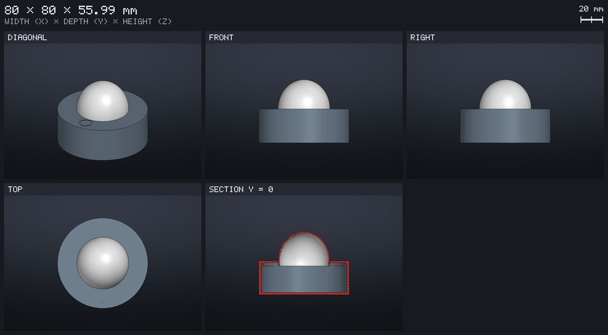
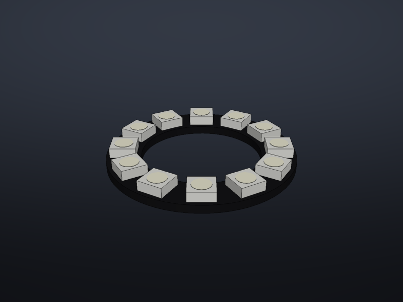
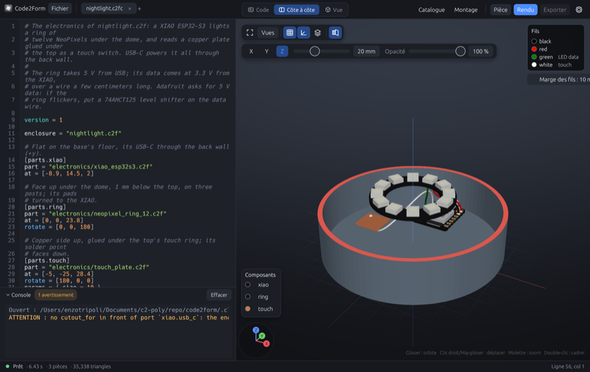
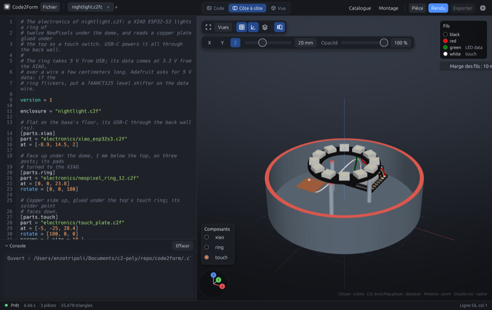
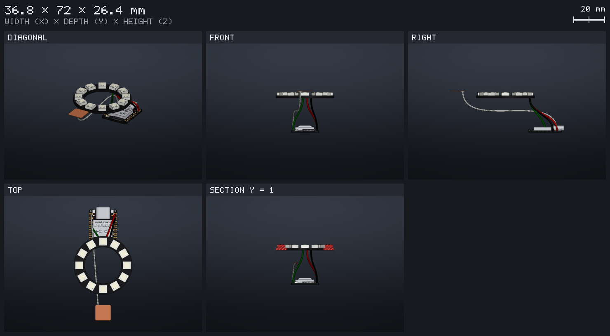
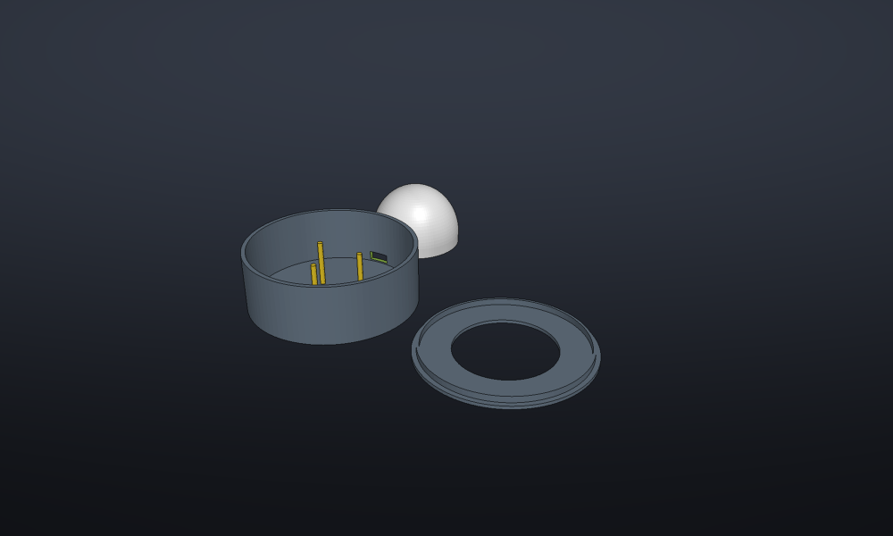

# From an idea to a night light

This page follows the MCP server's two prompts on a real example, a night
light that a touch switches on: what was given to the agent, what it
showed for approval, what the checks found and what was changed. The
result is in `examples/nightlight/`, and opens in the app.

## 1. The object: `design_object`

What was given:

> **description**: a night light, 80 mm across and about 5 cm high: a
> round base that holds the electronics, and a dome that spreads the
> light of a ring of LEDs. A touch on the top, at the front, switches it
> on and off.
>
> **constraints**: printed in PLA without supports, 2 mm walls, the dome
> in white PLA thin enough to glow.

The agent wrote `nightlight.c2f` as three pieces, each a `part()`: the
**Base** (a cup, open on top), the **Top** (a disc with the dome's
opening and a lip that presses into the base, the touch ring sunk into
it) and the **Dome** (a shell on a lip that presses into the top). Its
sizes are customizer parameters: the base's diameter and height, the
wall, the top's thickness (which a touch reaches through), the dome's
size and shell, the room left in each press fit. With `for_print` the
pieces lie side by side, each the way it prints.

It rendered it, then looked at it with `image` and `view = "sheet"`,
with `section = true` to see the walls, and showed this sheet for
approval:



## 2. The electronics: `add_electronics`

What was given:

> **design**: `examples/nightlight/nightlight.c2f`
>
> **components**: a XIAO ESP32-S3, https://www.adafruit.com/product/1643
> (a NeoPixel ring of 12), a copper plate as the touch pad.
>
> **behaviour**: powered by USB-C at the back; the ring glows under the
> dome; a touch on the top switches it.

### Finding the parts

`library_parts` with a `query` found the XIAO (`xiao`) and the touch
plate (`tactile`) in the library. The ring was not there, so the agent
read Adafruit's product page and NeoPixel guide, and wrote it: the board
to scale (36.8 mm outside, 23.3 mm inside, 1.6 mm board under 2 mm LEDs),
its four pads on the back with their voltages, and its sheet with the
product page and the guide as sources. What the pages do not give, the
place of the pads, it marked as estimated. `check_part` found nothing to
correct, and `save_part` filed it, where `library_parts` then finds it as
`anneau LED RGB`, `NeoPixel` or `lumière`. It is now in the library as
`electronics/neopixel_ring_12.c2f`.



### The wiring plan

Before going on, the agent gave its plan: ground, then 5 V from USB, then
data, as Adafruit wires a NeoPixel; the data on D3 and the touch on D0
(two touch pins, neither a strapping nor a serial pin). One reservation
was written into the circuit: the XIAO's data is at 3.3 V where Adafruit
asks for 5 V. Over a few centimeters of wire it usually works; if the
ring flickers, a 74AHCT125 level shifter goes on the data wire.

### The circuit, and what the checks found

`electrify` made the design ready. As it has three pieces, it asked which
one holds the electronics; with `piece = "Base"` it wrapped only the
base, both where the design draws it assembled and where it lays it out
for printing, and left the top and the dome as they were. The volume was
the same before and after.

The agent placed the parts in `nightlight.c2fc`, in the design's
coordinates: the XIAO flat on the floor with its USB-C at the back wall,
the ring face up 1 mm under the top with its pads turned to the XIAO, the
copper plate glued under the touch ring, and wrote the four wires.
`check_circuit` found no error. `fit` found two things, which the app
shows with the base cut at 20 mm:



- the back wall covers the XIAO's USB-C port: *no cutout_for in front of
  port `xiao.usb_c`*;
- the ring has nothing under it: it rests on nothing.

### The fixes

In the design, `electronics_cuts()` got the opening for the port,
`cutout_for("xiao", "usb_c", clearance = 0.5)`, and
`electronics_mounts()` three posts from the floor under the ring, clear
of its pads and of the XIAO. A first try of the posts reached the board:
`fit` said the ring was 0 mm from the enclosure, since the pads stand
0.02 mm under it. The posts now stop at the pads' plane, and `fit` finds
every part with its room:

```
part   clearance  enclosure  rests on  nearest part
xiao   0.84 mm    0.84 mm    0.00 mm   over 10 mm
ring   3.19 mm    3.19 mm    0.02 mm   touch 7.13 mm
touch  1.36 mm    1.36 mm    0.00 mm   ring 7.13 mm
nightlight.c2fc: 3 parts, everything fits with 0.5 mm of clearance
```



## 3. What comes out

The wiring, from `circuit_wires`, in the order to lay the wires, and the
parts from `circuit_bom`:

| Step | From | To | Color | Length |
|---|---|---|---|---|
| 1 | xiao.GND | ring.GND | black | 36.8 mm |
| 2 | xiao.5V | ring.5V | red | 39.2 mm |
| 3 | xiao.D3 | ring.DIN (LED data) | green | 34.3 mm |
| 4 | xiao.D0 | touch.PAD (touch) | white | 83.0 mm |

| Part | Quantity |
|---|---|
| Seeed Studio XIAO ESP32-S3 | 1 |
| Adafruit NeoPixel Ring 12 | 1 |
| Copper plate, 10 mm square | 1 |



Then `export`, with `for_print = true`, wrote the three pieces laid out
for the slicer as one 3MF. They come as one object, of three separate
shells: PrusaSlicer's *Split to objects* (Bambu Studio's *Split to
objects* too) makes them three, to give the dome its white filament. An
OBJ export keeps an object per `part()` instead.



## Try it

```
cargo run --release -p c2f-cli -- circuit check examples/nightlight/nightlight.c2fc
cargo run --release -p c2f-cli -- circuit fit examples/nightlight/nightlight.c2fc
cargo run --release -p c2f-cli -- circuit wires examples/nightlight/nightlight.c2fc
```

or open `examples/nightlight/nightlight.c2fc` in the app: the Section
button cuts the base open, and the Part button opens the design.
