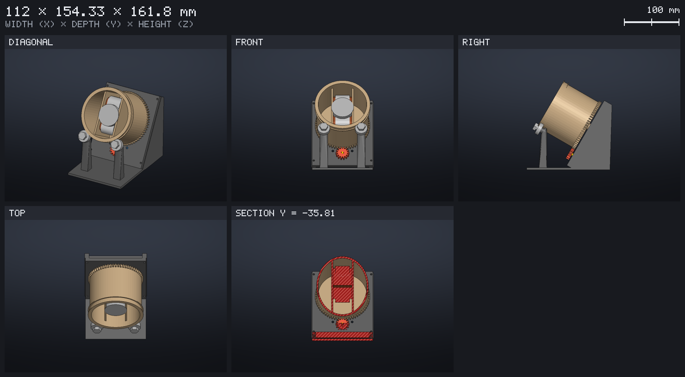
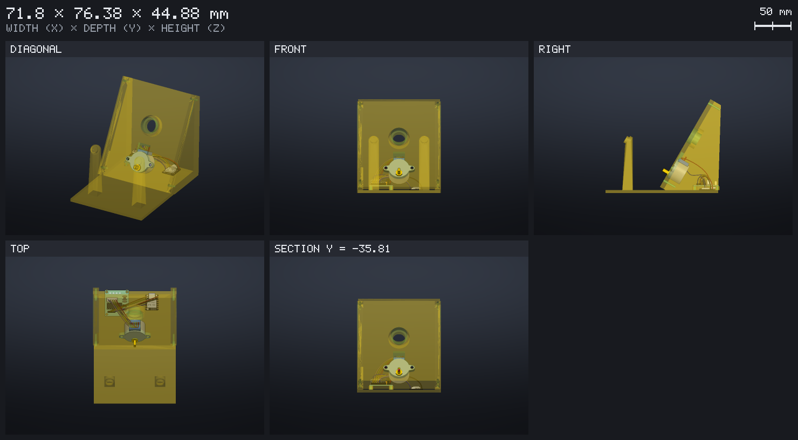

# Plan before drawing: the watch winder

The MCP server's first prompt, `plan_object`, comes before any model. The
agent draws nothing: it asks what the object must do, thinks it through
as an engineer would, and writes a brief that you approve. The design and
its electronics are then held to that brief. This page follows it on a
watch winder, where it changes the result: on paper, a motor that turns
the watch is enough; in practice, the motor must not carry the watch.
The result is in `examples/winder/`.

## 1. The questions

In Claude Code, `/mcp__code2form__plan_object` with the idea:

> a winder for my automatic watch, on my bedside table

The agent asks in short rounds, each question with a default you can
accept, and only what changes the design. Here:

- **Use**: one watch, on a bedside table, a few hours a day, quiet.
- **Size**: the watch on its bracelet, closed on a cushion; within 20 cm
  a side.
- **Pieces**: a drum that holds the cushion and turns, a frame.
- **Making**: PLA on a 220 x 220 x 250 mm printer, no supports; the
  cushion in TPU.
- **Electronics**: a XIAO ESP32-S3 on USB-C, a 28BYJ-48 stepper and its
  ULN2003 board.
- **Look**: the drum tilted towards the viewer, the face showing.

The answers open other questions. A motor asks what it drives (the watch
and its drum, about 300 g), where that weight sits (out front, the case
off the axis), how fast and how quiet. A box with no motor would have
skipped all of it.

## 2. The mechanical review

Then the agent goes through what the object must withstand, step by
step, and skips what does not apply. Here three steps change the design.

**Forces and supports.** The simplest winder puts the drum on the
motor's shaft. `loads` measures what that does, from
`examples/winder/motor_alone.json`:

```
c2f loads examples/winder/motor_alone.json
```

```
support  kind     at  radial   axial    moment  bearing load   friction
motor    motor  0 mm  2.63 N  1.52 N  119 N·mm        17.5 N  25.3 mN·m
WARNING: the motor `motor` holds the shaft alone, an overhung load: 2.63 N
hanging 45 mm past it, 119 N·mm on its bearings, 17.5 N on its front one;
a bearing near the loads takes it off the motor
```

The 28BYJ-48's gearbox turns its shaft in a plastic bushing. It is not
made to hold 310 g hung 45 mm in front of it. The decision: the drum
turns on its own bearings, a 608 pivot in the back plate and two 608
rollers under its front rim, and the motor only drives it.

**Torque and speed.** The watch's case, off the axis, needs 12.8 mN·m in
the worst position of a turn. With the friction of the motor's bushing
it is 38.2 mN·m, against the 28BYJ-48's 29.4:

```
WARNING: the motor gives 29.4 mN·m at the shaft for 38.2 needed: a margin
of 0.77, under 2; a 3:1 reduction (79.4 mN·m at the shaft) or a stronger
motor reaches it
```

The decision: a 14 to 64 tooth gear pair, 4.57:1, the pinion on the
motor and the ring as the drum's back.

**Balance.** The tilted drum moves the center of gravity forward.
`mass_properties` weighs the design with its boards and the watch, and
gives the angle it leans before it tips: 477 g, and 37°.

The other steps are covered in a few lines: material and printing,
fastening, assembly, energy (under 0.5 A on USB). Each risk gets its
assumption, its numbers, its decision, and what is left to check. Here
what is left is weighing the watch and test-printing the bearing's seat.

## 3. The brief

The plan ends on `examples/winder/brief.md`, written with `save_brief`,
which you read and approve. It holds:
- the answers;
- the review;
- the requirements a tool measures:

```markdown
## Requirements

- mass < 600 g
- tipping > 25°
- torque margin >= 2
- size <= 220 x 220 x 250 mm
- part "drum"
- part "pinion"
- component "electronics/xiao_esp32s3.c2f"
- component "parts/uln2003.c2f"
- component "parts/stepper_28byj48.c2f"
- prints without supports
- quiet enough for a bedroom
```

What the tools compute from sits in two fenced blocks:
- `json mass`: the material, the infill and the watch's 150 g;
- `json loads`: the drum's tilted shaft, its loads, the 608 pivot and
  rollers, the stepper's figures and the 4.57:1 ratio.

A requirement no tool measures, such as "quiet enough for a bedroom", is
kept for you to check.

## 4. The design, held to the brief

`design_object` with the brief draws the winder with the review's
decisions in it:
- the drum's front rim on two 608 rollers;
- a 608 pivot pressed into the back plate;
- the 14 to 64 gears;
- the motor in a pocket behind the plate, carrying nothing.



Then `add_electronics` places the boards and the motor in `winder.c2fc`
and wires them. `check_circuit` found one wire crossing the underside of
the plate; a `via` point takes it around. `fit` still reports the
motor's can 0.38 mm from its pocket: the pocket is made tight around the
can on purpose.



Before showing the result, `check_brief` measures the design and its
circuit against the brief:

```
holds       mass < 600 g                 476.6 g
holds       tipping > 25°                37.0°
holds       torque margin >= 2           9.41
holds       size <= 220 x 220 x 250 mm   every piece fits
holds       part "drum", part "pinion"
holds       component (the three boards and the motor)
unmeasured  prints without supports      for you to check
unmeasured  quiet enough for a bedroom   for you to check
```

If a later change drops the gears, for example, the torque margin falls
back under 2 and `check_brief` says so.

## The tools

| Tool | What it gives |
|---|---|
| `plan_object` (prompt) | The questions, the review and the brief |
| `save_brief`, `read_brief` | The brief written, and read back with its requirements and blocks |
| `mass_properties` | Masses as printed (material, infill, walls), the center of gravity, the tipping angle |
| `loads` | The torque a shaft needs, what each support takes, the margins and the reduction to aim for |
| `check_brief` | Each requirement holds, fails or is unmeasured, with the value measured |
| `library_parts` | The mechanical library (608 and other bearings, screws, inserts, couplings, gears, motors), to find what the review decides on |
