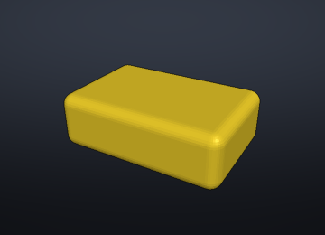
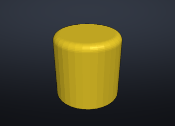
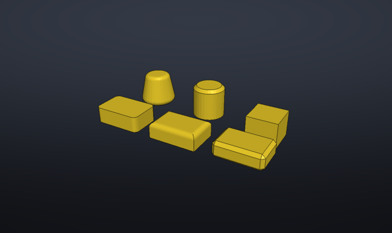
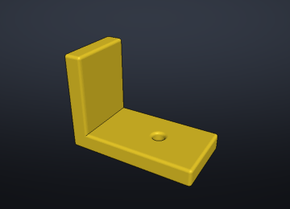
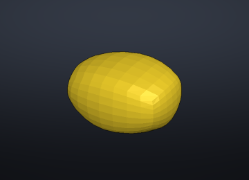
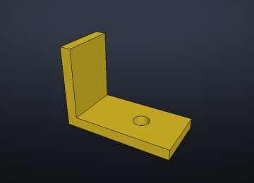
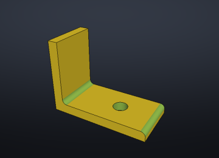
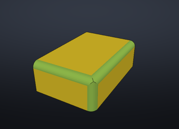

# Congés et chanfreins (C2F-43)

Dans Fusion, on clique une arête et on l'arrondit. Fusion travaille en
B-rep : une arête y est un objet, avec ses deux faces et leur géométrie
exacte. Code2Form travaille en maillages (Manifold) : une « arête » n'y est
qu'une suite de côtés de triangles, et le modèle est d'abord un programme.
Cette note compare trois façons d'arrondir ou de chanfreiner, mesurées sur
les mêmes modèles, et recommande quoi faire des options 2 et 3. L'option 1
est livrée.

## En bref

- **Option 1 (livrée)** : réécrire la primitive. `cube()` devient
  `rounded_cube()` ou `chamfered_cube()`, `cylinder()` devient
  `rounded_cylinder()` ou `chamfered_cylinder()`, depuis la bibliothèque
  `library/shapes/rounded.c2f`. Exact (boîte englobante identique, volume à
  0,1 % de la formule), rapide (moins de 15 ms), une ligne de code lisible.
- **Option 2 (abandonnée comme fonction du panneau)** : `minkowski()` ou
  ouverture morphologique. Arrondit tout ou rien, grossit la pièce
  (`minkowski()`) ou coûte des secondes et des centaines de milliers de
  triangles (ouverture : 19 s, 229 466 triangles sur une équerre).
- **Option 3 (à reprendre sous une forme réduite)** : le lissage de maillage
  de Manifold ne fait pas de congés. En revanche, choisir l'arête sur le
  maillage puis écrire dans le code un « outil » qui l'enlève (option 3′)
  est exact pour une arête droite entre deux plans, en 1 à 2 ms. C'est la
  suite à donner au ticket.

## Méthode

Chaque chiffre vient de `crates/geom/examples/fillet_research.rs` :

```sh
cargo run --release -p c2f-geom --example fillet_research
```

Le programme évalue et rend chaque modèle par la chaîne de Code2Form
(`c2f_eval::Program::load`, `c2f_eval::evaluate`, `c2f_geom::render`) et
mesure le temps (médiane de cinq passes, une seule pour les opérations
lentes, évaluation comprise), le nombre de triangles, le volume et la boîte
englobante. Les opérations qui n'existent pas dans le langage (ouverture,
lissage) appellent Manifold directement sur le solide rendu. Les images
sortent du moteur de rendu logiciel de `c2f-geom` (celui de l'outil MCP
`image`), sans fenêtre, dans la vue diagonale de l'application. Les courbes
sont à `$fn = 32`. Mesures faites sur un Mac Apple silicon, en `--release`.

Modèles :

- une boîte 30 × 20 × 10, ses douze arêtes arrondies à r = 2 ; volume
  attendu par la formule de Steiner (boîte intérieure grossie d'une boule) :
  5 804,7 mm³ ;
- un cylindre h = 20, r = 10, le bord du haut arrondi à r = 2 ; attendu par
  Pappus : 6 231,7 mm³ ;
- une équerre en L de 4 mm d'épaisseur percée d'un trou de r = 3, non
  convexe, arrondie à r = 1.

## Option 1 : réécrire la primitive

Le panneau des propriétés remplace l'appel sélectionné et ajoute la
bibliothèque en tête du fichier :

```scad
use <shapes/rounded.c2f>

rounded_cube([30, 20, 10], fillet = 2);                        // était cube([30, 20, 10])
chamfered_cube([30, 20, 10], chamfer = 1, edges = "vertical");
rounded_cylinder(h = 20, r = 10, fillet = 2, rims = "top");    // était cylinder(h = 20, r = 10)
chamfered_cylinder(h = 20, r1 = 10, r2 = 6, chamfer = 1, center = true);
```

| Méthode | Temps | Triangles | Volume | Écart à la formule | Boîte |
|---|---|---|---|---|---|
| `cube()` tel quel | 0,3 ms | 12 | 6 000,0 | — | 30,00 × 20,00 × 10,00 |
| `rounded_cube()` (bibliothèque) | 14,6 ms | 1 164 | 5 800,3 | −0,08 % | 30,00 × 20,00 × 10,00 |
| `hull()` de `sphere()` écrit à la main | 13,9 ms | 1 188 | 5 786,7 | −0,31 % | 29,98 × 19,98 × 9,98 |
| `rounded_cylinder()` (bibliothèque) | 0,5 ms | 640 | 6 190,5 | −0,66 % | 20,00 × 20,00 × 20,00 |

L'écart du cylindre est celui de la facettisation elle-même : un polygone à
32 côtés a 0,64 % de surface de moins que son cercle, et `cylinder(r = 10)`
à `$fn = 32` perd autant. Les tests (à `$fn = 96`) tiennent les quatre
modules sous 0,3 % de la formule analytique, pour chaque jeu d'arêtes, centré
ou non, et des cônes.

 

Les variantes : arêtes verticales, arêtes du dessus (les verticales restent
vives), chanfrein de toutes les arêtes ; cône aux deux bords arrondis,
cylindre au bord du haut chanfreiné, cube centré chanfreiné par le bas.



### Bibliothèque ou géométrie écrite dans le fichier ?

Le générateur pouvait aussi écrire la géométrie elle-même, par exemple
`hull() for (x = [2, 28], y = [2, 18], z = [2, 8]) translate([x, y, z]) sphere(2);`.
On a retenu l'appel de bibliothèque :

- **Lisible** : `rounded_cube([30, 20, 10], fillet = 2)` dit ce qu'il fait ;
  le `hull()` demande de reconstituer la boîte à partir des centres des
  sphères.
- **Paramétrique** : le rayon est un seul nombre. Avec le `hull()`, changer
  le rayon oblige à recalculer six coordonnées ; le panneau pourra aussi
  reconnaître l'appel et proposer de modifier le rayon ensuite.
- **Exact** : les anneaux de `sphere()` ne passent ni par les pôles ni par
  l'équateur, si bien que le `hull()` écrit à la main perd 0,02 mm sur
  chaque face (29,98 × 19,98 × 9,98) et 0,31 % de volume. Le module place
  ses courbes sur la boîte (sphères par `rotate_extrude()` d'un profil qui
  passe par les pôles, segments arrondis au multiple de 4), d'où une boîte
  identique et −0,08 %.
- **Les arêtes du dessus seules** n'ont pas d'écriture courte en `hull()` :
  là où deux congés se croisent sur une arête vive, le coin est
  l'intersection des deux congés. Le module le fait par l'intersection de
  deux profils extrudés ; écrit dans le fichier, ce serait une dizaine de
  lignes.

Le prix : le fichier dépend de la bibliothèque de Code2Form, qui est
livrée avec l'application et trouvée par `cargo run`, mais qu'OpenSCAD
n'a pas. Le fichier `rounded.c2f` est en OpenSCAD pur : il suffit de le
copier à côté du modèle pour l'ouvrir ailleurs.

### Limites

- Primitives seules, et seulement des jeux d'arêtes prédéfinis :
  toutes, verticales, du dessus, du dessous pour un cube ; haut, bas ou les
  deux pour un cylindre. Pas une arête choisie à la main, pas une pièce
  déjà assemblée par des booléens.
- Arrondir le bord le plus large d'un cône le rétrécit : ce bord est son
  plus grand cercle, la boîte perd alors de sa largeur (pas de sa hauteur).
  Même chose dans Fusion.
- La pointe d'un cône (`r2 = 0`) n'a pas de bord à arrondir : refusé.
- `$fn` non multiple de 4 : le module arrondit au multiple de 4 supérieur
  pour poser ses faces sur la boîte ; le `cylinder()` d'origine, lui, ne
  touche pas sa boîte en y. Écart de facettisation seulement.
- Un `cube()` ou un `cylinder()` dont les paramètres sont calculés
  (`cube([w, d, h])`) : le générateur prend des nombres. Au panneau de
  passer les valeurs évaluées ou de garder les expressions (voir l'API).

## Option 2 : le solide entier (`minkowski()`, ouverture)

`minkowski()` avec une sphère arrondit toutes les arêtes convexes, mais
grossit la pièce du rayon dans toutes les directions. Pour garder les
cotes, il faut d'abord la rétrécir du rayon, ce que le langage ne sait pas
faire en 3D (`offset()` est 2D) : sur une primitive, on rétrécit ses
paramètres à la main, ce qui revient à l'option 1 en moins exact. Manifold
offre aussi `minkowski_difference` : éroder puis dilater (une « ouverture »)
garde les cotes, sans passer par le langage.

| Modèle et méthode | Temps | Triangles | Volume | Écart | Boîte |
|---|---|---|---|---|---|
| Boîte, `minkowski()` de la boîte rétrécie | 1,8 ms | 1 182 | 5 786,7 | −0,31 % | 29,98 × 19,98 × 9,98 |
| Boîte, ouverture (Manifold) | 97,6 ms | 1 216 | 5 807,7 | +0,05 % | 30,00 × 20,00 × 10,00 |
| Cylindre, `minkowski()` (arrondit les deux bords) | 3,6 ms | 1 264 | 6 124,7 | −0,90 % (deux bords) | 19,98 × 19,98 × 19,98 |
| Équerre telle quelle | 0,5 ms | 158 | 5 167,6 | — | 40,00 × 20,00 × 30,00 |
| Équerre, `minkowski()` sphère r = 1 | 1 126 ms | 8 812 | 8 790,7 | — | 41,99 × 21,99 × 31,99 |
| Équerre, ouverture (Manifold) | 18 992 ms | 229 466 | 5 080,0 | — | 40,00 × 20,00 × 30,00 |

  

Constats :

- Sur une pièce convexe, `minkowski()` est rapide (Manifold prend alors un
  chemin convexe) ; sur l'équerre, non convexe, il passe à 1,1 s et
  grossit tout de 2 mm, trou compris (qui rétrécit d'autant).
- L'ouverture garde les cotes et arrondit toutes les arêtes convexes, trou
  compris, mais laisse vives les arêtes concaves (le coin intérieur du L).
  19 s et 229 466 triangles pour une équerre de 158 : inutilisable en
  aperçu à chaque frappe, et un maillage qui alourdit tout ce qui suit.
- Aucune des deux ne choisit une arête : tout ou rien.

**Recommandation : ne pas en faire une fonction du panneau.** `minkowski()`
reste disponible dans le langage pour qui le veut. Une instruction
« ouverture » (`rounded() { … }` sur un solide quelconque) ne vaut pas son
coût : des secondes par rendu pour un résultat qu'on ne règle pas arête
par arête. À reconsidérer seulement si Manifold accélère nettement
`minkowski_difference` sur les solides non convexes.

## Option 3 : au niveau du maillage

### Lissage de Manifold (`smooth_out` + `refine`)

Manifold sait lisser un maillage : il donne des tangentes aux arêtes moins
vives qu'un angle choisi, puis subdivise vers la surface lisse.

| Modèle et méthode | Temps | Triangles | Volume | Boîte |
|---|---|---|---|---|
| Boîte, `smooth_out(100°)` + `refine(8)` | 0,3 ms | 768 | 17 553,5 (+202 %) | 38,43 × 31,24 × 24,05 |
| Équerre, `smooth_out(60°)` + `refine(4)` | 1,2 ms | 2 528 | 5 531,3 | 41,68 × 20,00 × 31,68 |

 

Ce n'est pas un congé : soit l'arête est assez vive pour être gardée et
rien ne change, soit elle est lissée et la surface entière gonfle (la boîte
devient un œuf trois fois plus gros ; l'équerre déborde de 1,7 mm). Pas de
rayon, pas de cote tenue. **À écarter.**

### Détecter les arêtes sur le maillage

Pour cliquer une arête comme dans Fusion, il faut retrouver les arêtes
« vraies » dans les triangles, par l'angle entre faces voisines :

| Modèle | Côtés à plus de 30° | à plus de 60° |
|---|---|---|
| Équerre, trou à `$fn = 32` | 84 | 84 |
| Équerre, trou par défaut (`$fs = 2`, 10 facettes) | 50 | 40 |
| Boîte arrondie par l'option 1 | 0 | 0 |

L'équerre a 20 arêtes au sens de Fusion. Le maillage en montre 84 côtés
vifs : chaque bord du trou est 32 petits côtés, qu'il faut regrouper en
chaînes. Et avec la facettisation par défaut, les facettes du trou
tournent de 36° : à 30°, elles passent pour des arêtes. Le seuil dépend
donc de `$fn` ; il faut en plus savoir quelles faces sont planes et
lesquelles approchent un cylindre. Faisable, mais c'est un chantier en soi.

### Option 3′ : choisir l'arête sur le maillage, écrire l'outil dans le code

Pour une arête droite entre deux faces planes (le cas le plus courant :
pièces imprimées, boîtiers), il n'y a pas besoin de modifier le maillage.
Le clic donne l'arête (ses deux bouts et les normales de ses deux faces) ;
le panneau écrit un outil dans le code, qui enlève le coin (arête
convexe) ou le remplit (arête concave) :

```scad
difference() {
    equerre();
    translate([40, 0, 4]) edge_fillet(20, 2);       // arête du bout de la base
}
translate([4, 0, 4]) inside_fillet(20, 2);           // coin intérieur du L
```

| Modèle et méthode | Temps | Triangles | Volume | Boîte |
|---|---|---|---|---|
| Équerre, une arête arrondie et le coin intérieur rempli | 1,6 ms | 226 | 5 167,6 | 40,00 × 20,00 × 30,00 |
| Boîte, trois arêtes arrondies qui se rejoignent | 1,1 ms | 84 | 5 949,2 | 30,00 × 20,00 × 10,00 |

(Sur l'équerre, l'arête enlève (1 − π/4) × 2² × 20 = 17,17 mm³ et le coin
intérieur en ajoute autant : le volume retombe sur celui de départ.)

 

Constats :

- Exact sur l'arête choisie, rapide, peu de triangles, et le code reste
  le modèle : on y lit quelle arête est arrondie et de combien, on peut la
  retirer ou changer le rayon.
- Deux congés qui se croisent sur une arête vive se raccordent juste (c'est
  ce que fait `edges = "top"`).
- Trois congés qui se rejoignent en un sommet laissent une pointe (image de
  droite) : il y faudrait un morceau de sphère, ou de surface de raccord
  si les rayons diffèrent. Un outil de coin peut le traiter pour trois
  arêtes à angle droit et de même rayon ; le cas général est celui où un
  modeleur B-rep fait mieux.
- Arêtes courbes (bord d'un trou, d'un cylindre) : l'outil devient un tore
  ou une révolution, à traiter à part ; une arête sur une surface
  facettisée (sphère, `hull()`) n'a pas d'outil simple.
- Le code écrit dépend des cotes du moment : si le modèle change, l'outil
  reste où il était. Il vaut mieux l'écrire avec les mêmes variables que la
  pièce quand le panneau les connaît.

**Recommandation : pas de congé maillage générique (bevel ou fillet de
maillage).** Il faudrait reconstruire les arêtes, les faces et leurs
raccords à partir de triangles, ce qu'un B-rep a pour rien, et le résultat
ne serait plus du code. Faire plutôt l'**option 3′** dans un ticket à part :
sélection d'une arête droite entre deux plans dans la vue 3D (détection par
l'angle, chaînes de côtés colinéaires), puis écriture de
`edge_fillet()` / `edge_chamfer()` (convexe) ou `inside_fillet()` (concave)
de la bibliothèque, placé et orienté par une `multmatrix()`. Hors périmètre :
les coins à trois congés et les arêtes courbes.

## Recommandation

1. **Option 1** : livrée (`crates/studio/src/fillet.rs` et
   `library/shapes/rounded.c2f`), à brancher dans le panneau des
   propriétés pour un `cube()` ou un `cylinder()` sélectionné.
2. **Option 2** : non. `minkowski()` reste dans le langage ; pas de commande
   du panneau, pas d'opération d'ouverture.
3. **Option 3** : non au lissage et au congé de maillage génériques ;
   oui à l'option 3′ (arête droite cliquée, outil écrit dans le code),
   dans un ticket suivant.
